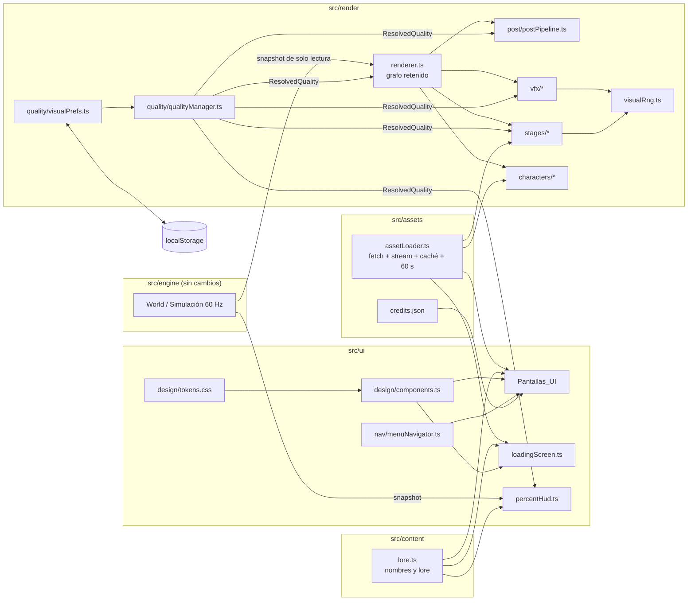
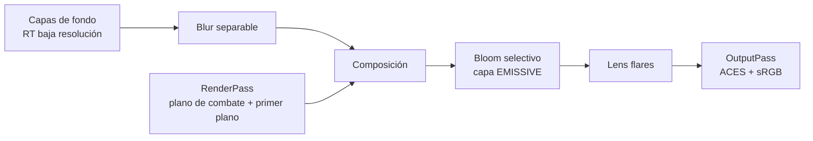

# Design Document — KiroBrawl Visual Redesign

## Overview

KiroBrawl es el rediseño visual completo del cliente: marca, sistema de diseño DOM, HUD, pantallas de carga con progreso real por bytes, presets de calidad granulares, postprocesado, VFX de cómic/arcade, escenarios 2.5D con capas y personajes GLTF/VRM con respaldo procedimental.

Principio rector: **la presentación es una función pura de lectura del Estado_Simulación**. Nada en `src/render/`, `src/ui/` o `src/assets/` escribe en `src/engine/`. Los ids de personajes y escenarios no cambian; solo cambian los nombres visibles, que se resuelven en la capa de contenido (`src/content/lore.ts`).

Decisiones clave:

- **Sin framework de UI**: se mantiene DOM imperativo en TypeScript, pero todas las pantallas pasan a construirse con una fábrica de componentes (`src/ui/design/components.ts`) y tokens CSS únicos (`src/ui/design/tokens.css`).
- **Grafo de escena retenido**: hoy `renderer.ts` reconstruye mallas y materiales cada frame (`rebuildDynamic` + `clearGroup`). El rediseño lo sustituye por objetos persistentes por jugador/plataforma y *pools* de VFX; cada frame solo actualiza transformaciones y uniforms. Es requisito para 60 fps en GPU integrada (R6.11).
- **Preset por defecto `medio`**, bajado a `bajo` solo si no se identifica la GPU o hay < 4 núcleos (R6.2).
- **Carga con tiempo límite global de 60 s** y progreso por bytes vía `fetch` + `ReadableStream` (R15).
- **Assets solo de mismo origen** y con licencias CC0/CC-BY/MIT/OFL (R14). Logo, retratos y vistas previas de escenario se generan como SVG procedimental (sin assets de terceros).
- **Tipografía**: display **Russo One** (OFL 1.1) para títulos y números del HUD; texto **Rajdhani** (OFL 1.1, pesos 500/600/700). Ambas autoalojadas en `public/fonts/` con `OFL.txt`.

### Fases de entrega

| Fase | Alcance | Requisitos |
|------|---------|-----------|
| 1 | Marca, contenido/lore, tokens y componentes, Navegador_Menús, rediseño de las 14 pantallas, HUD, fuentes, AssetLoader y Pantalla_Carga, créditos | R1–R5, R14, R15 |
| 2 | Gestor_Calidad y Preferencias_Visuales, Movimiento_Reducido, grafo retenido, iluminación de 3 luces, postprocesado, Sistema_VFX | R6–R9, R13 |
| 3 | Sistema_Escenarios con capas, animaciones de fondo y respaldo procedimental | R10 |
| 4 | Cargador_Modelos GLTF/VRM, Animador_Personaje, materiales por tipo, Modelo_Respaldo | R11, R12 |

R13 (aislamiento) es transversal: sus pruebas de invariancia se introducen en la fase 2 y se amplían en cada fase.

## Architecture



Flujo por frame: el bucle principal avanza la Simulación con su acumulador fijo de 60 Hz (sin cambios) y después llama a `renderer.render(snapshot, alpha, frameTimeMs)`. El renderer deriva un `VisualFrame` (posiciones interpoladas, eventos detectados por diferencia con el frame anterior: impactos, pérdidas de vida, inicio/fin de furia) y lo reparte a los subsistemas. Ningún subsistema recibe referencias mutables al `World`; reciben un `ReadonlyDeep<SimSnapshot>`.

Detección de eventos visuales: como la Simulación no emite eventos de render, `vfx/eventDetector.ts` compara el snapshot actual con el anterior (aumento de `damage`, flanco de `hitFlash`, cambio de `lives`, flanco de `furyActive`, nuevas entradas de `deathEffects`). Así no se toca el motor.

### Módulos nuevos y modificados

| Archivo | Estado | Responsabilidad |
|---------|--------|-----------------|
| `index.html` | mod | `<title>KiroBrawl</title>`, preload de fuentes |
| `src/ui/design/tokens.css` | nuevo | Único punto de declaración de variables CSS |
| `src/ui/design/components.ts` | nuevo | Fábrica de botón, panel, tarjeta, pestaña, interruptor, deslizador, diálogo |
| `src/ui/design/transitions.ts` | nuevo | Entrada/salida de pantallas con cancelación |
| `src/ui/nav/menuNavigator.ts` | nuevo | Foco por teclado/gamepad, trampas de foco, retorno de foco |
| `src/ui/loadingScreen.ts` | nuevo | Pantalla_Carga |
| `src/ui/creditsScreen.ts` | nuevo | Pantalla de créditos |
| `src/ui/brand/logo.ts` | nuevo | Logo SVG procedimental con respaldo de texto |
| `src/ui/brand/portraits.ts` | nuevo | Retratos y vistas previas de escenario en SVG |
| `src/ui/*.ts` (14 pantallas), `src/style.css` | mod | Migración a componentes y tokens; `style.css` pierde literales de color/fuente |
| `src/ui/percentHud.ts` | mod | HUD rediseñado (canvas 2D, lee tokens vía `getComputedStyle`) |
| `src/content/lore.ts` | nuevo | Nombres visibles, títulos y lore por id |
| `src/assets/assetLoader.ts` | nuevo | Carga con progreso por bytes, Caché_Assets, timeout |
| `src/assets/manifest.ts` | nuevo | Lista de assets por grupo (arranque, personaje, escenario) |
| `src/assets/credits.json` | nuevo | Registro_Créditos |
| `src/render/quality/visualPrefs.ts` | nuevo | Modelo, validación y persistencia de Preferencias_Visuales |
| `src/render/quality/qualityManager.ts` | nuevo | Presets, detección de hardware, resolución de calidad efectiva |
| `src/render/renderer.ts` | mod | Grafo retenido, orquestación, 3 luces |
| `src/render/post/postPipeline.ts` | nuevo | Bloom selectivo, DOF de fondo, destellos de lente |
| `src/render/vfx/*` | nuevo | `eventDetector`, `particlePool`, `impactFx`, `speedLines`, `cameraShake`, `trails`, `auras`, `koFx`, `flashLimiter` |
| `src/render/stages/*` | nuevo | `stageBuilder`, `layers`, `animatedProps`, `proceduralFallback`, una definición por escenario |
| `src/render/characters/*` | nuevo | `modelLoader`, `animator`, `materials`, `fallbackModel`, `fitToHitbox` |
| `src/render/visualRng.ts` | nuevo | PRNG visual independiente (mulberry32) |
| `src/render/background.ts` | mod | Absorbido por `stages/layers` |
| `src/engine/**` | **sin cambios** | — |

## Components and Interfaces

### Interfaces principales

```ts
// src/content/lore.ts
export interface CharacterLore { name: string; title: string; lore: string }
export interface StageLore { name: string; description: string }
export function characterLore(id: string): CharacterLore; // fallback: { name: id, title: id, lore: id }
export function stageLore(id: string): StageLore;         // fallback: { name: id, description: id }

// src/assets/assetLoader.ts
export type AssetKind = "font" | "image" | "svg" | "gltf" | "vrm" | "texture" | "json";
export interface AssetRequest { id: string; url: string; kind: AssetKind; sizeHint?: number }
export type AssetOutcome =
  | { status: "loaded"; data: ArrayBuffer; fromCache: boolean }
  | { status: "failed"; reason: "network" | "notFound" | "parse" | "timeout" };
export interface LoadHandle {
  progress(): LoadProgress;                    // ver Data Models
  onProgress(cb: (p: LoadProgress) => void): () => void; // emitido como máx. cada 100 ms
  done: Promise<Map<string, AssetOutcome>>;    // nunca rechaza
}
export interface AssetLoader {
  load(group: AssetRequest[], opts?: { timeoutMs?: number /* 60000 */ }): LoadHandle;
  cached(id: string): ArrayBuffer | undefined;
}

// src/render/quality/visualPrefs.ts
export function parseVisualPrefs(raw: unknown): VisualPreferences | null; // null = inválidas
export function serializeVisualPrefs(p: VisualPreferences): string;
export function loadVisualPrefs(storage: Storage | null): { prefs: VisualPreferences | null; storageOk: boolean };
export function saveVisualPrefs(storage: Storage | null, p: VisualPreferences): boolean;

// src/render/quality/qualityManager.ts
export interface HardwareInfo { gpuRenderer: string | null; logicalCores: number }
export function detectDefaultPreset(hw: HardwareInfo): "bajo" | "medio";
export function derivePresetLabel(controls: GraphicControls, lastPreset: PresetId): PresetLabel;
export interface QualityManager {
  get(): ResolvedQuality;                        // controles + reducedMotion efectivos
  selectPreset(id: PresetId): void;              // R6.12
  setControl<K extends ControlKey>(k: K, v: GraphicControls[K]): void;
  setReducedMotion(on: boolean): void;
  subscribe(cb: (q: ResolvedQuality) => void): () => void; // aplicación síncrona (< 1 s)
}

// src/render/visualRng.ts
export function createVisualRng(seed: number): () => number; // nunca toca el RNG del World

// src/render/vfx/particlePool.ts
export interface ParticlePool {
  setCapacity(max: number): void;  // recorta las más antiguas (R8.10)
  spawn(n: number, init: (i: number) => ParticleInit): void; // expulsa las más antiguas (R8.9)
  activeCount(): number;
  update(dtMs: number): void;
}

// src/render/characters/animator.ts
export type AnimState = "stun" | "dodge" | "shield" | "heavy" | "light" | "charge"
  | "wallSlide" | "jump" | "fall" | "run" | "idle" | "celebrate";
export function selectAnimState(v: PlayerVisualState): AnimState; // pura, prioridad R11.8

// src/ui/nav/menuNavigator.ts
export interface MenuNavigator {
  mount(root: HTMLElement, opts?: { dialog?: boolean; mandatory?: boolean; returnFocus?: HTMLElement }): () => void;
  pollGamepad(nowMs: number): void; // repetición: retardo 400 ms, cada 150 ms
}
```

## Data Models

### Controles gráficos y presets

```ts
export type Level = "desactivado" | "bajo" | "medio" | "alto";
export const LEVELS: Level[] = ["desactivado", "bajo", "medio", "alto"]; // orden total
export type RenderScale = 50 | 55 | 60 | 65 | 70 | 75 | 80 | 85 | 90 | 95 | 100;

export interface GraphicControls {
  particles: Level; flashes: Level; lensFlares: Level; bloom: Level; dof: Level;
  shadows: Level; cameraShake: Level; speedLines: Level; bgAnimations: Level;
  renderScale: RenderScale;
}
export type ControlKey = keyof GraphicControls;
export type PresetId = "bajo" | "medio" | "alto";
export type PresetLabel = PresetId | "personalizado";

export interface VisualPreferences {
  version: 1;
  preset: PresetLabel;     // preset mostrado
  lastPreset: PresetId;    // último preset seleccionado explícitamente
  controls: GraphicControls;
  reducedMotion: boolean;
}
```

Tabla de presets (cada columna es ≤ que la siguiente según `LEVELS` y el valor numérico de `renderScale`, cumpliendo R6.1):

| Control | `bajo` | `medio` (por defecto) | `alto` |
|---------|--------|-----------------------|--------|
| particles (máx. activas) | bajo (200) | medio (500) | alto (1000) |
| flashes | bajo | medio | alto |
| lensFlares | desactivado | bajo | alto |
| bloom | desactivado | bajo | alto |
| dof | desactivado | desactivado | medio |
| shadows | desactivado | bajo | alto |
| cameraShake | medio | medio | alto |
| speedLines | bajo | medio | alto |
| bgAnimations | bajo (2) | medio (4) | alto (6) |
| renderScale | 70 | 85 | 100 |

Significado de niveles por efecto (factor sobre el valor de `alto`): `desactivado` = 0 / pase omitido; `bajo` ≈ 0,4; `medio` ≈ 0,7; `alto` = 1. Bloom `bajo` usa media resolución y 3 mips; DOF solo actúa sobre capas de fondo (un desenfoque separable por capa, sin buffer de profundidad completo); sombras `bajo` = un único mapa 1024² para la luz principal, `alto` = 2048² con PCF.

`medio` está dimensionado para Iris Xe / Vega 8 a 1080p: sin DOF, bloom a media resolución y escala de render 85 %.

**Regla de `personalizado`** (pura, `derivePresetLabel`):

1. Si `controls` coincide campo a campo con `PRESETS[lastPreset]` → `lastPreset`.
2. Si no, si coincide con algún preset `p` en orden `bajo`, `medio`, `alto` → `p` (R6.7).
3. Si no → `"personalizado"` (R6.6).

`selectPreset(p)` asigna `controls = PRESETS[p]`, `lastPreset = p`, `preset = p` (R6.12).

**Persistencia y validación**: clave `kirobrawl.visualPrefs.v1` en `localStorage`. `parseVisualPrefs` exige JSON válido, `version === 1`, todos los campos presentes con su tipo, cada nivel dentro de `LEVELS`, `renderScale` en el conjunto permitido y `preset` en `PresetLabel`; además el `preset` guardado debe ser coherente con `derivePresetLabel(controls, lastPreset)` (si no, se recalcula en lugar de descartar). Cualquier otro fallo devuelve `null` → se aplica `detectDefaultPreset` con `reducedMotion` según `prefers-reduced-motion` y se sobrescribe (R6.10, R9.2–9.3). Las escrituras se agrupan con un *debounce* de 250 ms (< 1 s, R6.8). Si `setItem` lanza o `localStorage` no existe, se mantiene en memoria y se emite un aviso no bloqueante una vez por sesión (R6.13).

**Detección por defecto**: `gpuRenderer` se lee de `WEBGL_debug_renderer_info` (o `gl.getParameter(gl.RENDERER)`); `null` o cadena vacía/genérica ⇒ no identificada. `logicalCores = navigator.hardwareConcurrency ?? 0`. Resultado: `bajo` si no identificada o `< 4` núcleos; si no, `medio`.

`ResolvedQuality` = `controls` con los recortes de Movimiento_Reducido aplicados: `cameraShake` y `speedLines` forzados a `desactivado`, destellos de lente de impacto desactivados y limitador de destellos a pantalla completa (≤ 3/s) activo. Los valores guardados del usuario no se alteran.

### Progreso de carga

```ts
export interface AssetProgress { id: string; bytesTotal: number | null; bytesLoaded: number; done: boolean }
export interface LoadProgress {
  bytesLoaded: number;      // suma de processedBytes de cada asset
  bytesTotal: number | null;// null si algún asset no tiene tamaño conocido
  assetsDone: number;       // cargados + fallidos (incl. caché)
  assetsTotal: number;
  percent: number;          // entero 0..100
}
```

Tamaño conocido: `Content-Length` de la respuesta, o `sizeHint` del manifiesto generado en build (`scripts/gen-manifest` mide los archivos de `public/`). Un asset fallido o en caché cuenta `bytesLoaded = bytesTotal` y `done = true` (R15.9, R15.12).

Cálculo del porcentaje:

```
raw = bytesTotal !== null && bytesTotal > 0
      ? floor(100 * bytesLoaded / bytesTotal)
      : floor(100 * assetsDone / assetsTotal)
capped = assetsDone < assetsTotal ? min(raw, 99) : 100
percent = max(previousPercent, clamp(capped, 0, 100))
```

El `max` con el valor anterior garantiza monotonía aunque un `Content-Length` llegue tarde y cambie el denominador (R15.7); el tope en 99 garantiza R15.8. Si `assetsTotal === 0`, `percent = 100`. Al vencer los 60 s, los pendientes se marcan `failed: "timeout"` y el porcentaje pasa a 100 (R15.10). Textos: `"12,4 MB / 30,0 MB"` con `Intl.NumberFormat("es", { minimumFractionDigits: 1, maximumFractionDigits: 1 })` y `"N recursos restantes"`; refresco cada 100 ms (≤ 250 ms, R15.6).

### Definiciones visuales

```ts
export type MaterialType = "metal" | "leather" | "cloth" | "hair";

export interface CharacterVisualDef {
  id: CharacterId;                 // "blue" | "red" | "yellow" | "green" | "sandbag"
  modelUrl: string;                // p. ej. "models/characters/blue.vrm" (relativo a import.meta.env.BASE_URL)
  format: "gltf" | "vrm";
  dominantColor: string;           // hex, exclusivo entre los 4 seleccionables
  materialMap: Record<string, MaterialType>; // nombre de material del modelo → tipo
  animationClips: Partial<Record<AnimState, string>>; // nombre del clip en el archivo
  fallback: { silhouette: "lancer" | "brawler" | "mage" | "ranger" | "sack"; accent: string };
  portraitSeed: number;            // semilla del retrato SVG
}

export interface StageVisualDef {
  id: StageId;
  dominantBg: string;              // único por escenario (R10.4)
  keyLight: { color: string; intensity: number; dir: [number, number, number] };
  intenseLights: Array<{ x: number; y: number; z: number }>; // fuentes con destello de lente (R7.5)
  layers: Array<{ depth: "foreground" | "combat" | "far"; z: number; elements: StageElementDef[] }>;
  animatedProps: AnimatedPropDef[]; // ordenados por prioridad: los N primeros se animan según nivel
  previewSeed: number;
}

export interface CreditEntry {
  asset: string; author: string; sourceUrl: string; license: string; licenseUrl: string;
  files: string[];                 // rutas en el repo cubiertas por la entrada
  attribution?: string;            // obligatorio si la licencia lo exige (CC-BY)
  modified: boolean;
}
```

`credits.json` se valida en un test: todos los campos obligatorios no vacíos, licencia en la lista permitida (`CC0-1.0`, `CC-BY-4.0`, `MIT`, `OFL-1.1`), `attribution` presente si es `CC-BY-4.0`, y cada archivo de `public/models`, `public/textures`, `public/fonts` (salvo los propios generados) cubierto por exactamente una entrada (R14.1).

## Branding y contenido

**Logo**: SVG procedimental (`src/ui/brand/logo.ts`): palabra "KIROBRAWL" en Russo One convertida a trazos en build (para no depender de la fuente), inclinación −8°, relleno degradado primario→secundario, contorno grueso oscuro y destello de impacto en estrella tras la "B". `role="img"` y `aria-label="KiroBrawl"`. Si falla, se muestra un `<h1>` "KiroBrawl" con `--font-display` (R1.9).

Ambientación: el archipiélago flotante de **Aethra**, donde ruinas de piedra y acero de una civilización antigua conviven con bosques, mares y ciudades vivas. Los luchadores compiten en el Torneo del Núcleo por los fragmentos de energía que mantienen las islas en el aire.

### Personajes

| id | Nombre (≤ 20) | Título (≤ 40) | Lore (≤ 300) |
|----|---------------|---------------|--------------|
| `blue` | Kael | El Filo de la Marea | Capitán de la guardia costera de Aethra. Su armadura de acero templado en agua salada aguanta tormentas y golpes por igual. Lucha para que ningún fragmento caiga en manos de los piratas del cielo. |
| `red` | Vesper | La Llama Carmesí | Herrera y duelista de las forjas volcánicas. Lleva un guantelete de cuero endurecido que aún humea tras cada combate. Dice que solo quiere probar su metal, pero nadie la ha visto rendirse. |
| `yellow` | Sol | El Relámpago Dorado | Mensajero más rápido del archipiélago, criado entre los tejados de la ciudad neón. Convirtió las carreras de entrega en un estilo de combate y ahora busca el título para su barrio. |
| `green` | Ivy | La Guardiana del Bosque | Exploradora de los bosques colgantes de Aethra. Conoce cada raíz y cada ruina. Entra en el torneo para que los fragmentos dejen de arrancarse de los árboles que sostienen su hogar. |
| `sandbag` | Saco | El Incansable | Muñeco de entrenamiento cosido con lona y cuerda en el gimnasio del torneo. No gana nunca, pero tampoco se queja. Todos los campeones han empezado dándole golpes a él. |

### Escenarios

| id | Nombre (≤ 24) | Descripción (≤ 200) |
|----|---------------|--------------------|
| `neonIsland` | Distrito Neón | Una isla flotante coronada por rascacielos de cristal y letreros de neón. El tráfico aéreo cruza el horizonte nocturno mientras la lluvia brilla sobre el acero. |
| `sunsetIsland` | Risco de Pradera | Acantilado de roca rojiza cubierto de hierba alta, con molinos de piedra y nubes lentas sobre un valle infinito. |
| `voidIsland` | Santuario del Alba | Templo de mármol y musgo suspendido sobre un mar en calma, con faroles flotantes y una montaña nevada al fondo. |
| `training` | Sala de Pruebas | Gimnasio del torneo con rejilla de medición y focos de estudio. Aquí se afinan los combos antes de saltar a las islas. |

Las cadenas viven en `src/content/lore.ts`; un test comprueba las longitudes de R1.3/R1.4 y la cobertura de todos los ids. Todos los textos visibles (selector, HUD, repeticiones, post-partida, ranking) llaman a `characterLore(id).name` / `stageLore(id).name`; los `label`/`name` de `characters.ts` y `stages.ts` del motor no se usan para mostrar texto.

## Sistema de diseño

### Paleta (tokens `--color-*`)

Colores de marca y de estado (saturación HSL ≥ 70 %, luminosidad 35–70 %, R2.2):

| Token | Hex | HSL aprox. | Uso |
|-------|-----|-----------|-----|
| `--color-primary` | `#2F6BFF` | 223°, 100 %, 59 % | Botón principal, enlaces |
| `--color-secondary` | `#FF3D8B` | 336°, 100 %, 62 % | Degradados de marca, pestañas activas |
| `--color-focus` | `#FFD60A` | 50°, 100 %, 52 % | Anillo de foco |
| `--color-danger` | `#FF3B3B` | 0°, 100 %, 62 % | Errores, daño ≥ 150 % |
| `--color-success` | `#22E07A` | 148°, 75 %, 51 % | Confirmaciones |

Neutros (no sujetos a R2.2):

| Token | Hex | Uso |
|-------|-----|-----|
| `--color-bg` | `#0B0E1F` | Fondo de pantallas |
| `--color-surface` | `#161B36` | Paneles, tarjetas |
| `--color-surface-raised` | `#222A52` | Hover/presionado |
| `--color-border` | `#3A4478` | Bordes en reposo |
| `--color-text` | `#F4F6FF` | Texto principal |
| `--color-text-muted` | `#A9B2D9` | Texto secundario |
| `--color-on-primary` | `#FFFFFF` | Texto sobre primario (solo ≥ 18,66 px negrita) |
| `--color-on-accent` | `#0B0E1F` | Texto sobre foco/éxito/secundario |
| `--color-hud-neutral` | `#F4F6FF` | Daño al 0 % (R5.4) |

Contrastes (WCAG, calculados): `--color-text` sobre `--color-bg` ≈ 17:1 y sobre `--color-surface` ≈ 15:1; `--color-text-muted` sobre `--color-surface` ≈ 8:1; `--color-on-accent` sobre `--color-focus` ≈ 13:1; `--color-focus` como anillo sobre `--color-bg` ≈ 13:1 y sobre `--color-surface` ≈ 11:1 (≥ 3:1, R4.4). Blanco sobre `--color-primary` ≈ 4,6:1 (vale para texto normal). Un test unitario recalcula todos los pares declarados en `tokens.css` para cumplir R4.5; la verificación completa de accesibilidad requiere además pruebas manuales con tecnologías de asistencia.

### Tipografía

- `--font-display: "Russo One", "Arial Black", system-ui, sans-serif;` títulos, logo de respaldo, números del HUD.
- `--font-text: "Rajdhani", "Segoe UI", system-ui, sans-serif;` contenido.
- `@font-face` con `font-display: swap` desde `public/fonts/` (woff2, subconjunto latín + latín extendido). Si la fuente falla, el *stack* de respaldo mantiene la UI operable (R2.4).

| Token | Tamaño | Peso | Uso |
|-------|--------|------|-----|
| `--fs-display` | 64px | 400 (Russo One) | Título del menú |
| `--fs-h1` | 40px | 400 | Títulos de pantalla |
| `--fs-h2` | 28px | 700 | Secciones |
| `--fs-body-lg` | 20px | 600 | Botones, tarjetas |
| `--fs-body` | 17px | 500 | Texto |
| `--fs-caption` | 14px | 600 | Leyendas, atajos |
| `--fs-hud-percent` | 44px | 400 | Porcentaje de daño |

### Espaciado, radios, sombras, brillos, movimiento

- Espaciado (base 4 px): `--space-1: 4px` … `--space-2: 8px`, `--space-3: 12px`, `--space-4: 16px`, `--space-6: 24px`, `--space-8: 32px`, `--space-12: 48px`.
- Radios: `--radius-sm: 6px`, `--radius-md: 12px`, `--radius-lg: 20px`, `--radius-pill: 999px`. Los botones usan esquinas biseladas con `clip-path` (estética arcade) además del radio.
- Sombras: `--shadow-1: 0 2px 0 #05071280, 0 4px 12px #05071299`; `--shadow-2: 0 4px 0 #050712, 0 10px 28px #050712b3`.
- Brillos: `--glow-primary: 0 0 16px #2F6BFFaa`; `--glow-focus: 0 0 0 3px #FFD60A, 0 0 18px #FFD60A88`; `--glow-danger: 0 0 16px #FF3B3Baa`.
- Movimiento: `--dur-fast: 150ms`, `--dur-base: 220ms`, `--dur-slow: 400ms`; `--ease-out: cubic-bezier(.2,.8,.2,1)`, `--ease-pop: cubic-bezier(.3,1.4,.5,1)`. Todas las transiciones de pantalla usan un token entre 150 y 400 ms (R2.8).

`tokens.css` es el único archivo que declara estas variables (R2.1); un test de lint recorre `src/**/*.css` y `src/**/*.ts` buscando declaraciones `--color-|--font-|--fs-|--space-|--radius-|--shadow-|--glow-|--dur-` fuera de él, y literales `#hex`/`rgb(` en estilos de Pantalla_UI (R2.7).

### Componentes (`src/ui/design/components.ts`)

```ts
export interface BaseOpts { label: string; disabled?: boolean; id?: string }
export function button(o: BaseOpts & { variant?: "primary" | "secondary" | "ghost" | "danger"; onActivate: () => void }): HTMLButtonElement;
export function panel(o: { title?: string; children: Node[] }): HTMLElement;
export function card(o: BaseOpts & { media?: Node; subtitle?: string; onActivate?: () => void }): HTMLElement;
export function tabs(o: { tabs: { id: string; label: string }[]; selected: string; onChange: (id: string) => void }): HTMLElement;
export function toggle(o: BaseOpts & { checked: boolean; onChange: (v: boolean) => void }): HTMLElement; // role="switch"
export function slider(o: BaseOpts & { min: number; max: number; step: number; value: number; format?: (v: number) => string; onChange: (v: number) => void }): HTMLElement;
export function levelSelect(o: BaseOpts & { value: Level; onChange: (v: Level) => void }): HTMLElement; // control segmentado de 4 niveles
export function dialog(o: { title: string; body: Node[]; actions: HTMLElement[]; mandatory?: boolean; onClose?: () => void }): { el: HTMLElement; open(): void; close(): void };
export function setDisabled(el: HTMLElement, disabled: boolean): void;
```

Estados visuales (cada uno difiere del reposo en al menos una propiedad, R2.5):

| Estado | Selector | Cambio respecto a reposo |
|--------|----------|--------------------------|
| reposo | — | `--color-surface`, borde `--color-border`, `--shadow-1` |
| foco | `:focus-visible`, `[data-focused]` | `--glow-focus` (anillo 3 px) y escala 1,04 |
| presionado | `:active`, `[data-pressed]` | `--color-surface-raised`, desplazamiento Y +2 px, sombra reducida |
| deshabilitado | `[aria-disabled="true"]` | opacidad 0,45, sin brillo, `cursor: not-allowed` |

Deshabilitado (R2.6): se usa `aria-disabled="true"` más el atributo `disabled` nativo en botones; el manejador `onActivate` está envuelto por una guarda que ignora clic, Enter/Espacio y botón A del gamepad mientras esté deshabilitado, y el Navegador_Menús lo excluye del orden de foco (R4.3).

### Transiciones de pantalla

`transitions.ts` mantiene una única transición activa. `show(next)` / `hide(current)`:

1. Si hay una transición en curso, llama a `finish()`: cancela las animaciones (`Animation.finish()` de Web Animations API), aplica el estado final y elimina del DOM la pantalla saliente (R2.9).
2. Lanza la nueva con `element.animate()`: entrada = opacidad 0→1 + `translateY(12px)→0` + escala 0,98→1 en `--dur-base`; salida = inverso en `--dur-fast`.
3. Al terminar, el Navegador_Menús enfoca el primer control habilitado (≤ 100 ms, R4.9).

### Movimiento reducido en la UI

Con `reducedMotion` activo se añade `data-reduced-motion` a `<html>`. `transitions.ts` sustituye desplazamiento y escala por fundido de opacidad en `--dur-base` (220 ms, dentro de 150–400 ms, R9.8); los estados de foco y presionado dejan de escalar y usan solo color/brillo; el HUD sustituye la sacudida del porcentaje por un cambio de escala nulo con pulso de color. El cambio de la opción se aplica vía `qualityManager.subscribe` en el mismo frame (R9.5).

## Pantallas

Todas las pantallas se construyen con `components.ts`, se montan con `menuNavigator.mount()` y entran/salen con `transitions.ts`. Rejilla base de 12 columnas con márgenes `--space-12`; por debajo de 1280×720 el contenedor raíz pasa a `overflow-y: auto` con una sola columna (R3.8).

| Pantalla | Disposición | Notas |
|----------|-------------|-------|
| Carga inicial | Logo centrado, barra de progreso (pill, relleno degradado primario→secundario), `%` en `--fs-h1`, línea "12,4 MB / 30,0 MB · N recursos restantes", consejo/lore rotatorio (≤ 200 caracteres) | Bloquea el menú hasta que el grupo `boot` termina (R15.1) |
| Menú principal | Logo arriba-izquierda; columna de botones (Jugar, Online, Entrenamiento, Repeticiones, Gacha, Ranking, Opciones, Créditos); fondo = escena 3D en vivo de `neonIsland` con cámara orbital lenta y postprocesado según calidad | Con Movimiento_Reducido la cámara queda fija |
| Selección de personaje | Fila de tarjetas (retrato SVG + nombre); panel derecho con vista previa 3D en reposo, nombre (`--fs-h1`), título y lore; fichas de jugador P1–P4 abajo con color del jugador y estado (listo/CPU) | Cambio de foco actualiza el panel en el mismo frame (< 200 ms, R3.2); vista previa usa `fallbackModel` hasta cargar o tras 60 s (R3.6) |
| Selección de escenario | Rejilla 2×2 de `card` con preview SVG (`portraits.ts`) y nombre visible; descripción del enfocado debajo | Si la preview falla: marcador con `--color-surface` y nombre (R3.7) |
| HUD | Ver subsección siguiente | Canvas 2D sobre WebGL |
| Pausa | Diálogo obligatorio en partida local: Continuar, Opciones, Salir | Escape/B = Continuar |
| Opciones | `tabs`: Gráficos, Accesibilidad, Controles, Audio | Ver detalle abajo |
| Reasignación de teclas | Lista de acciones × jugador; al activar, diálogo "Pulsa una tecla" | Misma persistencia que hoy (R3.4) |
| Gacha | Panel de moneda, botón de tirada (x1/x10), revelado de tarjetas con destello | Peticiones al servidor sin cambios |
| Ranking | `tabs` por modo, tabla con avatar, nombre y puntuación; fila propia resaltada | Mismo endpoint |
| Online / lobby | Crear sala, unirse por código, lista de jugadores con fichas, estado de conexión | Mensajes de red sin cambios (R13.4) |
| Post-partida | Ganador con modelo en celebración, tabla de estadísticas, botones Revancha / Guardar repetición / Menú | Usa nombres visibles |
| Repeticiones | Lista de `card` con fecha, escenario y personajes (nombres visibles, R1.6); reproductor con barra de tiempo y controles | Ids en bruto nunca se muestran |
| Tutorial | Panel lateral con paso actual, indicador de progreso y botones Anterior/Siguiente | |
| Diálogos | `dialog()` centrado, velo `--color-bg` al 70 %, trampa de foco | Escape/B cierra si no es obligatorio (R4.10) |
| Créditos | Lista desplazable de entradas con los cinco campos y la atribución; botón Volver | Flechas/stick desplazan; B vuelve (R14.7) |
| Carga previa a partida | Igual que la carga inicial más retratos de los personajes elegidos y preview del escenario | Si todo está en caché: 100 % y arranque ≤ 1 s (R15.13) |

### HUD

- Un panel por jugador (2–4), anclados abajo y repartidos en `n` columnas iguales con ancho máximo 360 px; el ancho se recalcula en `resize` para no solaparse ni recortarse en 1280–2560 px (R5.8).
- Contenido: retrato circular (SVG rasterizado una vez a `ImageBitmap`), nombre visible en `--font-text`, porcentaje en `--font-display` `--fs-hud-percent` con "%" más pequeño, vidas como iconos individuales y barra de furia.
- Color del porcentaje: `t = clamp(damage / 150, 0, 1)`, interpolación en espacio OKLab entre `--color-hud-neutral` y `--color-danger` (monótona en `t`; R5.4).
- Sacudida: al detectar aumento de daño, `shake = { start: now }`; duración 220 ms; desplazamiento `A·sin(ωt)·(1−p)` y escala `1 + 0,25·(1−p)²`; con `p = 1` vuelve a escala 1 y offset 0. Un nuevo aumento reinicia `start` (R5.2, R5.3). Con Movimiento_Reducido: solo pulso de color.
- Pérdida de vida: el icono perdido se rompe en 4 fragmentos durante 400 ms (R5.5). Con 0 vidas: retrato con filtro de saturación 0 y opacidad 0,5 (R5.6).
- Furia: relleno `clamp(fury / FURY_MAX, 0, 1)`; activa = barra llena con degradado animado y brillo `--glow-danger` (R5.7).
- El HUD lee los tokens una vez con `getComputedStyle(document.documentElement)` y los vuelve a leer si cambian las preferencias.

### Opciones

- **Gráficos**: selector de preset (`bajo`/`medio`/`alto`; muestra "Personalizado" como etiqueta no seleccionable cuando `derivePresetLabel` lo indica); un `levelSelect` por cada Control_Gráfico (partículas, destellos, destellos de lente, bloom, profundidad de campo, sombras, vibración de cámara, líneas de velocidad, animaciones de fondo) y un `slider` 50–100 % paso 5 para la escala de render. Cada cambio llama a `qualityManager` y se aplica en el mismo frame (R6.3–R6.7).
- **Accesibilidad**: `toggle` Movimiento_Reducido (R9.1) con texto de ayuda.
- **Controles**: acceso a reasignación de teclas y prueba de gamepad.
- **Audio**: controles existentes migrados a `slider`.

## VFX

`vfx/eventDetector.ts` compara `prev` y `curr` (snapshots de solo lectura) y emite `VisualEvent[]`; ningún efecto depende de callbacks del motor.

| Evento | Detección (diff de snapshot) | Efecto | Duración |
|--------|------------------------------|--------|----------|
| `hit` | `damage` sube o flanco de subida de `hitFlash`; uno por jugador golpeado y tick | Destello de impacto (sprite aditivo) + onda de choque | 120 ms / 350 ms |
| `heavyHit` | `hit` cuyo atacante tiene ataque activo `heavy` | Además: líneas de velocidad + vibración de cámara + destello de lente | 100–400 ms según knockback |
| `stun` | `stunned > 0` | Estela de trayectoria (ribbon de 16 puntos) | Mientras dure + desvanecido 250 ms |
| `charge` | carga activa, ratio `r ∈ [0,1]` | Partículas brillantes en espiral | Se cortan en el frame del flanco de bajada |
| `fury` | flanco de `furyActive` | Aura (shell fresnel aditiva) | Aparece en el frame; desvanece 250 ms |
| `ko` | nueva entrada en `deathEffects` o `lives` baja | Estallido en el borde | 1,2 s |

- **Onda de choque**: anillo en un `PlaneGeometry` con shader propio: `alpha = smoothstep(r-w, r, d) * (1 - smoothstep(r, r+w, d))`, `r` crece con `easeOutCubic`, borde dentado con ruido 1D y contorno oscuro estilo cómic. Escala: ligero 0,6, pesado 1,0–1,6 según knockback (R8.3).
- **Escalado por knockback**: `k = clamp(kb / KB_MAX_HEAVY_FULL, 0, 1)`, donde `KB_MAX_HEAVY_FULL` se calcula una vez desde la tabla de ataques del motor (lectura). Vibración: duración `100 + 300k` ms, amplitud `A_max·k`, decaimiento exponencial con ruido del `visualRng`. Líneas de velocidad: `8 + 24k` quads orientados según el vector de knockback, duración igual a la vibración (R8.2). Ambas multiplicadas por el factor del nivel de su Control_Gráfico.
- **KO**: el borde se elige comparando la posición con los límites de la blast zone (el eje con mayor exceso relativo); el abanico de rayos se orienta con la normal hacia el interior (R8.7).
- **Movimiento_Reducido**: `cameraShake` y `speedLines` resueltos a `desactivado` (R9.6) y destello de lente de impacto omitido (R7.7).

### Pool de partículas

- Un único `InstancedMesh` (quad billboard, material aditivo) con capacidad física 1000 y atributos instanciados (color, tamaño, vida).
- Buffer circular ordenado por instante de creación: `spawn` escribe en la cabeza; si `active + n > cap`, se descartan primero las más antiguas (R8.9). Los destellos, ondas y vibración no usan el pool, así que nunca se pierden.
- `setCapacity(cap)` con `cap ∈ {0, 200, 500, 1000}` según `particles`; recorta inmediatamente las más antiguas sobrantes (R8.8, R8.10). `mesh.count = activeCount()`.
- Toda aleatoriedad visual sale de `createVisualRng(seed)` (R13.5).

### Limitador de destellos

`vfx/flashLimiter.ts` (puro): con Movimiento_Reducido, cada destello cuya área proyectada supera el 25 % del viewport consulta `allow(nowMs)`, que mantiene una cola de los instantes aceptados en la ventana deslizante `(now − 1000, now]`; acepta si hay < 3 y descarta en otro caso (R9.7). Los destellos ≤ 25 % no pasan por el limitador.

## Postprocesado

`post/postPipeline.ts` envuelve `EffectComposer` (addons de Three.js) y reconstruye la lista de pases solo cuando cambia `ResolvedQuality`.



- **Escala de render**: `renderer.setPixelRatio(devicePixelRatio · renderScale/100)`; el HUD y la UI DOM no se escalan.
- **Bloom selectivo**: los materiales emisivos y los VFX brillantes se marcan en la capa `EMISSIVE`. Se renderiza esa capa a un RT de media resolución (resto en negro), se aplica `UnrealBloomPass` y se suma a la escena (R7.3). `bajo`: media resolución, 3 mips, intensidad 0,6; `alto`: resolución completa, 5 mips.
- **DOF barato**: las capas `far` del escenario se dibujan en un RT a 1/2 (medio) o 1/4 (bajo) de resolución con desenfoque gaussiano separable y se componen detrás del plano de combate; el plano de combate, plataformas, personajes y VFX no pasan por el desenfoque (R7.4). Sin buffer de profundidad completo.
- **Destellos de lente**: addon `Lensflare` en cada `intenseLights` del escenario (visible solo dentro del frustum); destellos de impacto como `Lensflare` temporal de 0,4 s en el punto del golpe pesado (R7.5).
- **Salida**: `ACESFilmicToneMapping`, exposición 1,0, `outputColorSpace = SRGBColorSpace`.
- Un control en `desactivado` elimina su pase de la lista (R7.6); con todos desactivados se usa `renderer.render` directo.

| Control | Coste relativo (Iris Xe, 1080p) | `medio` |
|---------|--------------------------------|---------|
| renderScale | Lineal con píxeles | 85 % |
| bloom | Medio (RT media resolución) | `bajo` |
| dof | Medio-alto (RT extra + blur) | desactivado |
| lensFlares | Bajo | `bajo` (solo luces intensas, sin ghosts extra) |
| shadows | Medio (mapa 1024²) | `bajo` |

## Escenarios

`stages/stageBuilder.ts` construye una vez por partida un `Group` por capa a partir de `StageVisualDef`. Las plataformas visuales se generan desde las cajas de colisión del motor (lectura de `stages.ts`): la cara superior y los laterales coinciden con la caja; solo se añade decoración por debajo y detrás. Un test proyecta las esquinas con la cámara de juego a 1920×1080 y exige ≤ 2 px de desviación (R10.3).

Capas (R10.1): `foreground` (z delante de la cámara de combate, solo en los márgenes laterales e inferiores fuera de la zona visible de combate, opacidad ≤ 0,6), `combat` (plataformas y personajes, z = 0) y `far` (varias subcapas con paralaje).

| Escenario | Fondo dominante | Luz principal | Primer plano | Lejano | Elementos animados (orden de prioridad) |
|-----------|-----------------|---------------|--------------|--------|----------------------------------------|
| Distrito Neón (`neonIsland`) | `#140A2E` noche violeta | `#7FD4FF` cian | Cables y farolas en esquinas | Rascacielos de cristal, letreros, horizonte | 1 tráfico aéreo, 2 letreros parpadeantes, 3 lluvia, 4 reflejos en charcos, 5 focos de búsqueda, 6 dirigible |
| Risco de Pradera (`sunsetIsland`) | `#E86A3A` atardecer | `#FFB36B` ámbar | Hierba alta en el borde inferior | Valle, molinos de piedra, nubes | 1 nubes, 2 aspas de molino, 3 hierba ondulante, 4 pájaros, 5 polen, 6 rayos de sol |
| Santuario del Alba (`voidIsland`) | `#1F5E6B` turquesa profundo | `#FFE7C2` blanco cálido | Ramas con musgo | Montaña nevada, mar en calma, templo de mármol | 1 faroles flotantes, 2 olas del mar, 3 niebla, 4 pétalos, 5 cascada, 6 auroras |
| Sala de Pruebas (`training`) | `#1A1D24` gris grafito | `#FFFFFF` foco de estudio | Barandillas | Rejilla de medición, gradas | 1 rejilla de escaneo, 2 pantallas de datos, 3 focos oscilantes, 4 partículas de polvo, 5 dron cámara, 6 marcador |

Luces intensas (destello de lente): focos de búsqueda (Neón), sol (Pradera), farol mayor (Santuario), focos de estudio (Pruebas).

- **Animaciones**: cada `AnimatedPropDef` es `pose(tRender)` periódica (`t mod period`, funciones seno/lerp con extremos iguales) para bucles sin saltos (R10.2). Se animan los `N` primeros con `N = {desactivado: 0, bajo: 2, medio: 4, alto: 6}` (R10.5); los no animados quedan en su pose `t = 0`. Los elementos visibles se acumulan por nivel (el conjunto de `bajo` ⊆ `medio` ⊆ `alto`).
- **Tiempo**: solo `performance.now()` del render; nunca ticks ni estado del motor (R10.6).
- **Cambio de calidad**: `stageBuilder.applyQuality(q)` activa/desactiva props y subcapas sin reconstruir plataformas (R10.7).
- **Movimiento_Reducido**: velocidad × 0,4 y amplitud × 0,5; parpadeos y destellos de fondo a intensidad constante (R10.9).
- **Respaldo procedimental** (`proceduralFallback.ts`): si falla una textura/modelo/capa, se sustituye por degradado vertical del color dominante + siluetas extruidas generadas con `visualRng` de semilla fija; las plataformas usan geometría de cajas con borde emisivo (R10.8).

## Personajes

### Assets

- Fuentes permitidas: **Quaternius** (CC0, modelos y animaciones riggeadas), **Kenney** (CC0, accesorios/props) y modelos creados con **VRoid Studio** con licencia de redistribución explícita del autor (o creados por el propio proyecto). Todos con entrada en `credits.json`.
- No se usan exportaciones de Mixamo en crudo (sus términos no permiten redistribuir los archivos en un repositorio público).
- Pipeline: `gltf-transform` (optimize, draco/meshopt, texturas KTX2 o WebP ≤ 1024²); objetivo ≤ 15k triángulos y ≤ 3 MB por personaje. Archivos en `public/models/characters/{id}.glb|.vrm`.
- Carga: `GLTFLoader` (+ `MeshoptDecoder`) y, para VRM, `@pixiv/three-vrm` (versión fija). `modelLoader` recibe el `ArrayBuffer` del AssetLoader (`loader.parse`), así el progreso es por bytes reales.

### Normalización a la caja de colisión

`fitToHitbox(bbox, hitbox)`: escala no uniforme acotada `sx = hw/bw`, `sy = hh/bh`; si `sx/sy ∉ [0,87; 1,15]` se usa escala uniforme `s = sy` y se acepta el error horizontal siempre que quede en ±15 %; si no, se aplica `sx` limitado para cumplir ±15 % (R11.2, R12.1). Traslación: `minY` del modelo al borde inferior de la caja y centro X alineado.

### Materiales

`materials.ts` clasifica por `materialMap` (o por nombre: `metal|armor`, `leather|belt`, `hair`, resto tela) (R7.2):

| Tipo | Material | Parámetros |
|------|----------|-----------|
| metal | `MeshPhysicalMaterial` | metalness 1, roughness 0,25, clearcoat 0,3 |
| cuero | `MeshStandardMaterial` | metalness 0, roughness 0,55, specular medio |
| tela | `MeshStandardMaterial` | metalness 0, roughness 0,95 |
| pelo | `MeshPhysicalMaterial` | roughness 0,4, `anisotropy` 0,8 alineada a tangentes (banda alargada) |

Rim light: además de la luz de contorno real (R7.1), `onBeforeCompile` añade un término fresnel `pow(1 - dot(N, V), 3) · rimColor` modulado por la dirección de la luz de contorno, para que el borde sea visible con cualquier preset (incluso sin sombras ni bloom). El mismo chunk aplica el tinte de golpe (`uHitTint`, R11.5).

### Animador

`selectAnimState(v)` (pura) evalúa en el orden de R11.8: `stun → dodge → shield → heavy → light → charge → wallSlide → jump → fall → run → idle`; `celebrate` lo fuerza el post-partida para el ganador (R11.9).

- `AnimationMixer` con un `AnimationAction` por estado; cambio de estado = `crossFadeTo` de 120 ms (≤ 150 ms, R11.10). `light`, `heavy` y `dodge` hacen `reset().play()` con fundido 0 en el primer frame activo.
- Orientación: `yaw` objetivo `±90°`; interpolación con velocidad tal que el giro completo dura 80 ms (R11.4).
- Clips que faltan: se reutiliza el más cercano (`fall` → `jump`, `wallSlide` → `fall`, `charge` → `heavy` congelado) sin romper la máquina de estados.

### Modelo_Respaldo y contingencia

- `fallbackModel.ts` compone primitivas (cápsulas, conos, cajas biseladas) según `fallback.silhouette` (lancer, brawler, mage, ranger, sack) con material toon de 3 bandas + rim fresnel y el `dominantColor` del personaje. Se escala con `fitToHitbox`. Muestra orientación, escudo (esfera translúcida), carga (pulso emisivo) y destello de golpe con los mismos tiempos del snapshot (R12.4).
- Contingencia si no se consiguen modelos con licencia válida a tiempo para la fase 4: mantener el Modelo_Respaldo como visual definitivo mejorado (voxels o sprites 2D billboard generados por el proyecto) sin bloquear las fases 1–3.

## Error Handling

| Fallo | Detección | Respuesta | Requisitos |
|-------|-----------|-----------|------------|
| Fuente no carga | `document.fonts.load` rechaza o timeout | Se usa el stack de respaldo de los tokens; la UI sigue operable | R2.4 |
| Logo SVG falla | `onerror` / excepción al construir | `<h1>` "KiroBrawl" con `--font-display` en la misma posición | R1.9 |
| Carga > 60 s | Temporizador global del `LoadHandle` | Pendientes → `failed: "timeout"`, 100 %, continuar con respaldos | R12.2, R15.10 |
| Error de red / 404 | `fetch` lanza / `status` 404 | Asset `failed` (`network`/`notFound`), cuenta como procesado | R12.1, R15.9 |
| Modelo no interpretable | `loader.parse` lanza | Modelo_Respaldo; un `console.error` por personaje y partida con id, ruta y motivo | R12.1, R12.3 |
| Modelo llega tras timeout | Marca `timedOut` por personaje | Se ignora; sigue el respaldo toda la partida | R12.2 |
| Textura falta | Error en `TextureLoader`/imagen embebida | Color identificativo en esa ranura; `console.error` con id y ruta | R12.8 |
| Preview 3D / preview escenario falla | Outcome `failed` | Modelo_Respaldo / marcador con nombre | R3.6, R3.7 |
| Asset de escenario falla | Outcome `failed` | `proceduralFallback` para esa capa | R10.8 |
| `localStorage` no disponible o `setItem` lanza | `try/catch` | Prefs en memoria; aviso no bloqueante una vez por sesión | R6.13 |
| Prefs inválidas | `parseVisualPrefs` → `null` | Preset por defecto + RM según media query, se sobrescriben | R6.10 |
| Pérdida de contexto WebGL | `webglcontextlost` | `preventDefault`, se pausa solo el render; la Simulación sigue; en `webglcontextrestored` se reconstruye el grafo | R13.7 |
| Excepción en render/VFX | `try/catch` alrededor de `renderer.render` | Se registra una vez y se salta el frame; el bucle de simulación no se ve afectado | R13.7 |
| Id sin lore | `characterLore`/`stageLore` | Devuelven el id | R1.8 |

## Correctness Properties

*A property is a characteristic or behavior that should hold true across all valid executions of a system-essentially, a formal statement about what the system should do. Properties serve as the bridge between human-readable specifications and machine-verifiable correctness guarantees.*

Las propiedades se prueban sobre módulos puros (`visualPrefs`, `qualityManager`, `progress`, `particlePool`, `flashLimiter`, `animator`, `lore`, `fitToHitbox`, `eventDetector`, `hudModel`) y sobre el `World` del motor en modo headless. Varios criterios que repiten la misma garantía (7.8, 9.9, 10.6, 11.7, 12.7, 13.8) quedan cubiertos por la Propiedad 13.

### Property 1: Ida y vuelta de Preferencias_Visuales

*For any* `VisualPreferences` válidas (cualquier etiqueta de preset incluida `personalizado`, cualquier combinación de niveles y `reducedMotion`), `parseVisualPrefs(JSON.parse(serializeVisualPrefs(p)))` es igual campo a campo a `p`.

**Validates: Requirements 6.9, 6.8**

### Property 2: Preferencias inválidas producen un estado válido por defecto

*For any* valor arbitrario no válido (JSON corrupto, campos ausentes, tipos incorrectos, niveles o preset fuera de rango), `parseVisualPrefs` devuelve `null` y el Gestor_Calidad inicializado con él produce preferencias válidas con `controls = PRESETS[detectDefaultPreset(hw)]` y las escribe en el almacenamiento.

**Validates: Requirements 6.10**

### Property 3: Preset por defecto según hardware

*For any* `HardwareInfo`, `detectDefaultPreset` devuelve `bajo` si y solo si la GPU no está identificada o `logicalCores < 4`, y `medio` en otro caso; nunca devuelve `alto`.

**Validates: Requirements 6.2**

### Property 4: Derivación de preset y personalizado

*For any* `GraphicControls` y `lastPreset`, `derivePresetLabel` devuelve un `PresetId` `p` si y solo si `controls` es igual a `PRESETS[p]` (prefiriendo `lastPreset`), y `personalizado` si no coincide con ninguno; además, tras `setControl(k, v)` el control efectivo `k` vale `v` (salvo recortes de Movimiento_Reducido) y tras `selectPreset(p)` `controls = PRESETS[p]` y la etiqueta es `p`.

**Validates: Requirements 6.5, 6.6, 6.7, 6.12**

### Property 5: Monotonía de presets

*For any* Control_Gráfico `c`, `PRESETS.bajo[c] ≤ PRESETS.medio[c] ≤ PRESETS.alto[c]` según el orden de `LEVELS` (o el valor numérico para `renderScale`).

**Validates: Requirements 6.1**

### Property 6: Movimiento_Reducido en la calidad resuelta

*For any* `GraphicControls`, resolver con `reducedMotion = true` da `cameraShake = speedLines = desactivado` y destellos de lente de impacto desactivados, sin modificar los controles guardados; y el valor inicial de Movimiento_Reducido es `saved.reducedMotion` si hay preferencias válidas guardadas y `mediaQuery === true` en otro caso.

**Validates: Requirements 9.2, 9.3, 9.4, 9.6, 7.7**

### Property 7: Pases de postprocesado según controles

*For any* `ResolvedQuality`, la lista de pases del pipeline contiene bloom, DOF y destellos de lente si y solo si su control es distinto de `desactivado`.

**Validates: Requirements 7.6**

### Property 8: Invariantes del porcentaje de carga

*For any* grupo de assets (con y sin tamaño conocido, incluidos assets en caché) y cualquier secuencia intercalada de eventos de bytes recibidos, assets completados, fallidos y timeout, cada porcentaje mostrado está en `[0, 100]`, no decrece respecto al anterior, es `100` si y solo si todos los assets están cargados o fallidos, coincide con `floor(100·bytes/total)` (o `floor(100·done/total)` si algún tamaño es desconocido) salvo los topes de monotonía y 99, y "recursos restantes" es `assetsTotal − assetsDone`.

**Validates: Requirements 15.3, 15.4, 15.5, 15.7, 15.8, 15.9, 15.10, 12.5**

### Property 9: Caché de assets sin peticiones de red

*For any* grupo de carga y subconjunto de sus assets presente en la Caché_Assets, `fetch` no se invoca para los assets cacheados y estos cuentan como procesados en el primer `LoadProgress`.

**Validates: Requirements 15.12**

### Property 10: Color de daño monótono y fijado en 150 %

*For any* par de daños `0 ≤ d1 ≤ d2`, el parámetro de interpolación cumple `t(d1) ≤ t(d2)`, `t(0) = 0` (color neutro) y `t(d) = 1` (color de peligro) para todo `d ≥ 150`.

**Validates: Requirements 5.4**

### Property 11: Sacudida del porcentaje con reinicio

*For any* secuencia de instantes de aumento de daño, la animación de sacudida termina como máximo 300 ms después del último aumento, su duración está en `[100, 300]` ms y en su final la escala es 1 y el desplazamiento 0.

**Validates: Requirements 5.2, 5.3**

### Property 12: Modelo de HUD por jugador

*For any* snapshot con 2–4 jugadores, el modelo del HUD contiene exactamente un panel por jugador con nombre visible, porcentaje como entero seguido de "%", un indicador por vida restante (ninguno activo y retrato atenuado con 0 vidas) y relleno de furia `clamp(fury/FURY_MAX, 0, 1)` con estado distinto si la furia está activa.

**Validates: Requirements 5.1, 5.6, 5.7**

### Property 13: Invariancia de la simulación ante la presentación

*For any* semilla, secuencia de entradas aleatorias de 1 a N ticks y `VisualPreferences` (preset, niveles y Movimiento_Reducido), ejecutar el `World` con el render headless, el `eventDetector`, el Sistema_VFX, el Sistema_Escenarios y el animador activos produce, en cada tick, un Estado_Simulación (jugadores, posiciones, velocidades, daño, vidas y estado del RNG) idéntico al de ejecutar el `World` solo; y el snapshot es igual antes y después de cada frame dibujado.

**Validates: Requirements 13.1, 13.2, 13.7, 13.8, 7.8, 9.9, 10.6, 11.7, 12.7**

### Property 14: Independencia del RNG visual

*For any* estado del `World` y cualquier número de llamadas a `createVisualRng` / generación de partículas con cualquier densidad, el estado del RNG de la Simulación es el mismo antes y después.

**Validates: Requirements 13.5**

### Property 15: Tasa de fotogramas no altera la simulación

*For any* secuencia de duraciones de frame entre 1/240 s y 1 s con tiempo total `T`, el acumulador fijo simula `floor(T·60)` ticks y el Estado_Simulación de cada tick es idéntico al de una ejecución con frames de 1/60 s.

**Validates: Requirements 13.6**

### Property 16: Pool de partículas acotado con expulsión de las más antiguas

*For any* secuencia de `spawn`, `update` y `setCapacity` con capacidades de `{0, 200, 500, 1000}`, `activeCount()` nunca supera la capacidad vigente y las partículas supervivientes son siempre las creadas más recientemente.

**Validates: Requirements 8.8, 8.9, 8.10**

### Property 17: Limitador de destellos a pantalla completa

*For any* secuencia temporal de destellos con áreas arbitrarias y Movimiento_Reducido activo, en cualquier ventana de 1 s se muestran como máximo 3 destellos de más del 25 % del área y no se descarta ningún destello de área ≤ 25 %.

**Validates: Requirements 9.7**

### Property 18: Un par destello/onda por impacto

*For any* par de snapshots consecutivos con `k` jugadores golpeados en el mismo tick, `eventDetector` emite exactamente `k` eventos `hit` y el Sistema_VFX crea `k` destellos y `k` ondas centrados en cada punto de impacto, aunque el pool de partículas esté lleno.

**Validates: Requirements 8.1, 8.9**

### Property 19: Intensidad de impacto según tipo y knockback

*For any* `kb1 ≤ kb2` de golpes pesados, la amplitud y la duración de la vibración y de las líneas de velocidad de `kb1` no superan las de `kb2`, la duración está en `[100, 400]` ms y alcanza el máximo en `KB_MAX_HEAVY_FULL`; *for any* golpe ligero, no hay líneas de velocidad ni vibración y su destello y onda son menores que los de cualquier golpe pesado.

**Validates: Requirements 8.2, 8.3**

### Property 20: Partículas de carga monótonas

*For any* `r1 ≤ r2` en `[0, 1]`, la tasa de emisión y el brillo de las partículas de carga para `r1` no superan los de `r2`.

**Validates: Requirements 8.5**

### Property 21: Borde de KO

*For any* posición de eliminación fuera de la blast zone, el efecto de KO se coloca en el borde cuyo límite se excede en mayor proporción y su dirección apunta hacia el interior del escenario.

**Validates: Requirements 8.7**

### Property 22: Animaciones de fondo en bucle y por nivel

*For any* prop animada y tiempo `t`, `pose(t) = pose(t + period)`; *for any* escenario y nivel de animaciones de fondo, el número de props animadas es `0/2/4/6`, el conjunto visible de un nivel contiene al del nivel inferior y con Movimiento_Reducido la velocidad y la amplitud son ≤ 50 % de las normales sin parpadeos.

**Validates: Requirements 10.2, 10.5, 10.9**

### Property 23: Alineación de plataformas

*For any* escenario y plataforma de su definición de colisión, los bordes superior, izquierdo y derecho de la geometría visual proyectada a 1920×1080 se desvían como máximo 2 px de los de la caja de colisión.

**Validates: Requirements 10.3**

### Property 24: Ajuste del modelo a la caja de colisión

*For any* caja envolvente de modelo con dimensiones positivas y caja de colisión, `fitToHitbox` produce una silueta cuyo ancho y alto están dentro de ±15 % de los de la caja y cuya base coincide con el borde inferior de la caja.

**Validates: Requirements 11.2, 12.1**

### Property 25: Prioridad de estados de animación

*For any* `PlayerVisualState`, `selectAnimState` devuelve el estado de mayor prioridad en el orden aturdimiento, esquiva, escudo, pesado, ligero, carga, pared, salto, caída, carrera, reposo, entre los que cumplen sus condiciones de R11.3.

**Validates: Requirements 11.3, 11.8**

### Property 26: Transiciones y giro del modelo

*For any* secuencia de estados de animación y orientaciones con pasos de frame arbitrarios, cada fundido dura ≤ 150 ms, los estados ligero, pesado y esquiva empiezan con fundido 0 en su primer frame y el modelo alcanza la nueva orientación ≤ 100 ms después del primer frame con ella.

**Validates: Requirements 11.4, 11.10**

### Property 27: Un único error por personaje

*For any* secuencia de fallos repetidos (red, 404, parse, timeout) de los modelos de una partida, `console.error` se invoca exactamente una vez por personaje fallido, con su id, ruta y motivo.

**Validates: Requirements 12.3**

### Property 28: Resolución de nombres visibles

*For any* cadena `s`, `characterLore(s).name` y `stageLore(s).name` no lanzan y valen el nombre de la tabla si `s` es un id registrado (distinto del id) y `s` en otro caso.

**Validates: Requirements 1.7, 1.8**

### Property 29: Componentes deshabilitados y transiciones

*For any* secuencia de eventos de activación (clic, Enter, Espacio, botón A) sobre un componente deshabilitado, su `onActivate` se ejecuta 0 veces; *for any* secuencia intercalada de `show`/`hide`, tras cada llamada solo la pantalla destino queda visible.

**Validates: Requirements 2.6, 2.9**

### Property 30: Orden de foco y trampa de diálogo

*For any* conjunto generado de controles con posición, visibilidad y estado, el orden de foco son los controles habilitados y visibles ordenados por fila y columna; *for any* diálogo con `n ≥ 1` controles y secuencia de Tab/Mayús+Tab/flechas, el foco permanece dentro del diálogo y avanza de forma cíclica.

**Validates: Requirements 4.3, 4.6**

### Property 31: Repetición de foco del gamepad

*For any* secuencia temporal de pulsación mantenida de una dirección, el primer movimiento repetido ocurre entre 300 y 500 ms después del inicial y los siguientes con una separación ≥ 150 ms.

**Validates: Requirements 4.2**

## Testing Strategy

- **Herramientas**: `vitest` (ya usado en `server/`; se añade al cliente) y `fast-check` con versiones fijadas exactas en `package.json` (p. ej. `"fast-check": "3.23.2"`, sin `^`). Entorno `node` para módulos puros y `jsdom` para componentes, navegador y foco. Ejecución con `npx vitest --run`.
- **Propiedades**: una única prueba con `fc.assert(..., { numRuns: 100 })` como mínimo por propiedad (las de simulación, Propiedades 13 y 15, con secuencias de hasta 3.600 ticks por caso y una ejecución nocturna con 36.000). Cada prueba lleva el comentario `// Feature: kirobrawl-visual-redesign, Property {n}: {texto}`. No se implementa PBT a mano.
- **Diseño para pruebas**: la lógica vive en módulos puros sin WebGL (`visualPrefs`, `qualityManager`, `progress`, `particlePool` con almacenamiento en arrays, `flashLimiter`, `eventDetector`, `animator`, `fitToHitbox`, `hudModel`, `stageAnim`). Three.js se usa solo en adaptadores finos; la Propiedad 13 usa un renderer con `THREE.Scene` sin `WebGLRenderer`.
- **Unitarias (ejemplos y bordes)**:
  - AssetLoader con `fetch` simulado que devuelve `ReadableStream` troceados, sin `Content-Length`, 404, error de red, timeout con fake timers y caché.
  - Tablas de lore (longitudes y cobertura de ids, R1.3–R1.4), paleta (HSL, R2.2), contrastes de pares de tokens (R4.5), lint de tokens/literales (R2.1, R2.7), `credits.json` y cobertura de archivos (R14.1, R14.2, R14.5), manifiesto solo con URLs relativas (R14.4).
  - Logo y fallback, fuentes de respaldo, diálogos (retorno de foco, Escape/B, opener eliminado), transición de 150–400 ms, debounce de guardado ≤ 1 s y `localStorage` que lanza.
  - Modelo_Respaldo ante cada motivo de fallo, textura ausente, preview de escenario ausente y `proceduralFallback`.
- **Integración/regresión**: payloads de red y peticiones al servidor comparados con snapshots previos al rediseño (R13.4, R3.4); repeticiones de referencia grabadas antes del rediseño reproducidas hasta el final con ganador, vidas, daño y ticks idénticos (R13.3); pérdida simulada de contexto WebGL (R13.7).
- **Manual**:
  - Rendimiento: partida de 4 jugadores, 60 s, preset `medio`, 1920×1080 en Intel Iris Xe y AMD Radeon Vega 8; media ≥ 60 fps medida con el overlay de depuración (R6.11).
  - Layout sin solapes ni recortes en 1280×720, 1920×1080 y 2560×1440, y desplazamiento por debajo de 1280×720 (R3.5, R3.8, R5.8).
  - Accesibilidad: navegación completa solo con teclado y solo con gamepad, indicador de foco y contraste. Los tests automáticos de contraste no sustituyen una validación WCAG completa, que requiere pruebas manuales con tecnologías de asistencia y revisión experta.
  - Revisión visual de iluminación (rim, materiales), bloom selectivo, DOF y destellos por escenario (R7.1–R7.5, R10.1, R10.4).
